# Logvex Fleet Manager

A desktop command center for running and supervising a fleet of Minecraft bot instances. It
manages accounts, servers, groups and deployments, assigns each bot a role
(**GEARER**, **STASIS** or **HUNTER**), tracks a target database, and connects to one or more
**LogVex Hunter** Meteor clients over their companion API.

Built with **Electron + React + TypeScript + Vite**. Each bot runs in its own isolated Node worker
process, so one crashing or hanging bot never takes down the application.

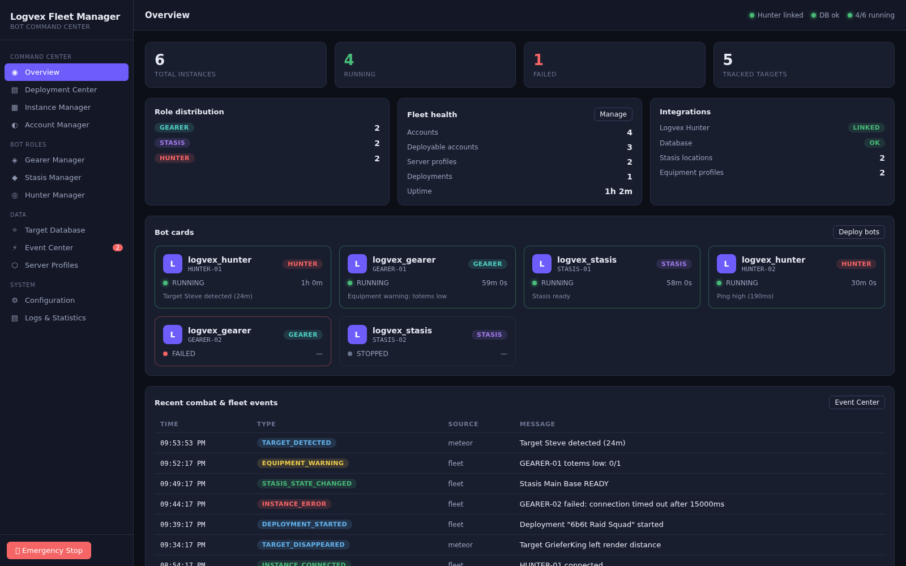

---

## Features

### Command Center
- **Overview** — fleet health at a glance: instance counts, connection states, recent events and
  live notifications.
- **Deployment Center** — build a deployment from accounts, a server profile and roles; validate
  it, preview the plan, then start, pause, resume, cancel, retry individual items and export/import
  presets.
- **Instance Manager** — create, start, stop, restart and command individual bot instances; view
  per-instance logs and metrics.
- **Account Manager** — register offline/Microsoft/Mojang accounts, store credentials in the OS
  keychain (with an encrypted-file fallback), and prepare logins.

### Bot Roles
- **Gearer Manager** — equipment profiles and inventory evaluation for GEARER bots.
- **Stasis Manager** — track stasis locations and their state (READY / UNAVAILABLE / ACTIVE /
  UNKNOWN / ERROR) with a change history.
- **Hunter Manager** — the bridge to LogVex Hunter clients: connection health, live snapshot
  (bot state, players, targets, modules, stats) and remote commands.

### Data
- **Target Database** — a local target list that syncs bidirectionally with connected Hunter
  clients.
- **Event Center** — a searchable stream of fleet events and a notification inbox.
- **Server Profiles** — the servers the bots connect to.

### System
- **Configuration** — application settings, API token, import/export of the whole configuration.
- **Logs & Statistics** — aggregated logs and statistics.

### Cross-cutting
- **Emergency stop** — one control halts every instance, cancels deployments and engages the
  coordinator's stop state; per-instance stop is also available.
- **Local HTTP + WebSocket API** — the same functionality as the UI, for automation, at
  `/api/v1/*` with `/events` for the event stream (token-authenticated).
- **Resilient Hunter integration** — an unreachable addon degrades to "disconnected" instead of
  throwing into the UI.

---

## Screenshots

| | |
| --- | --- |
| 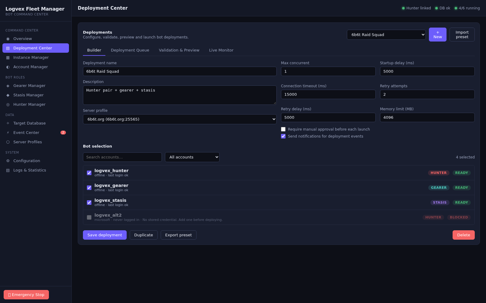 | 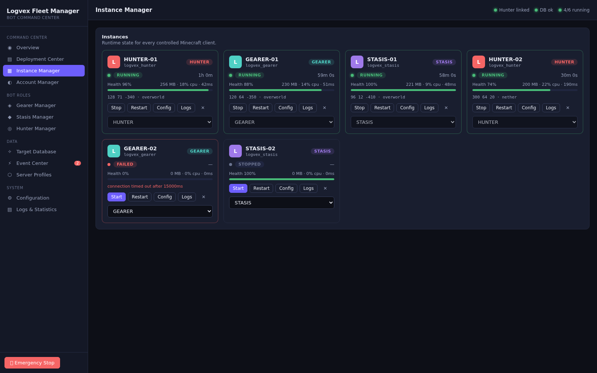 |
| Deployment Center | Instance Manager |
| 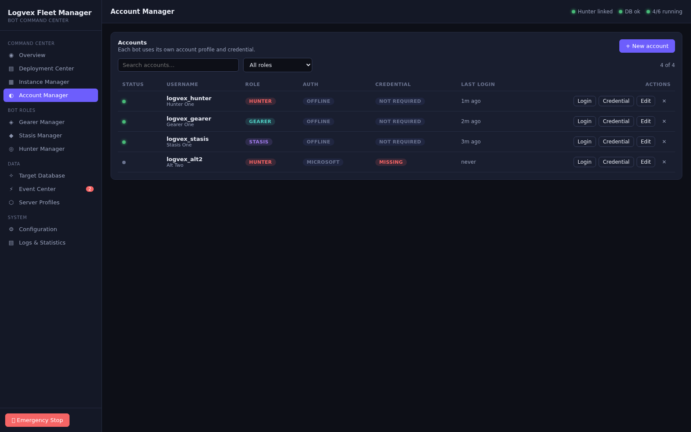 | 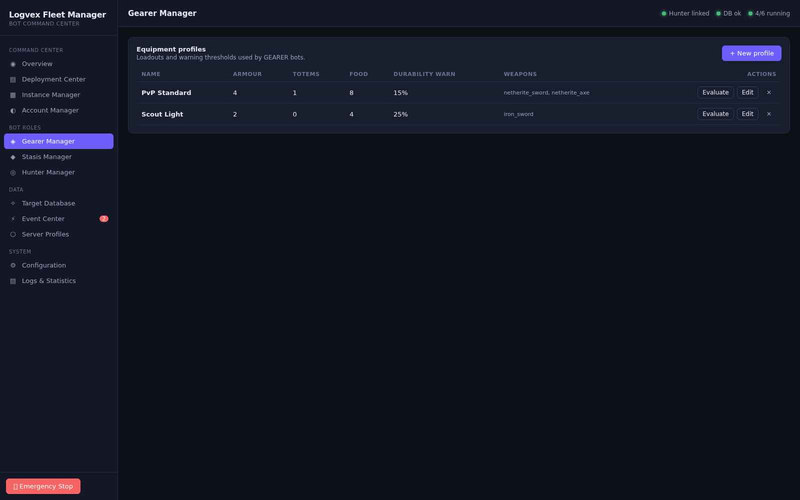 |
| Account Manager | Gearer Manager |
| 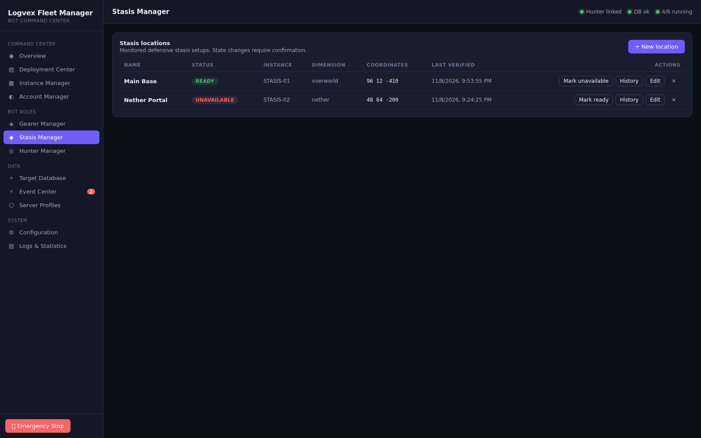 | 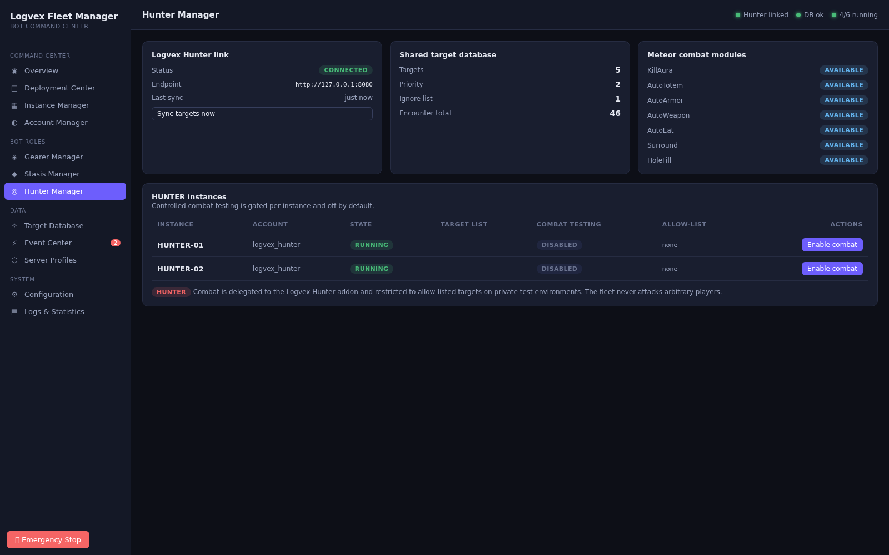 |
| Stasis Manager | Hunter Manager |
| 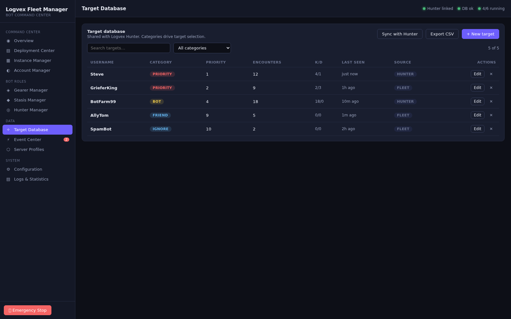 | 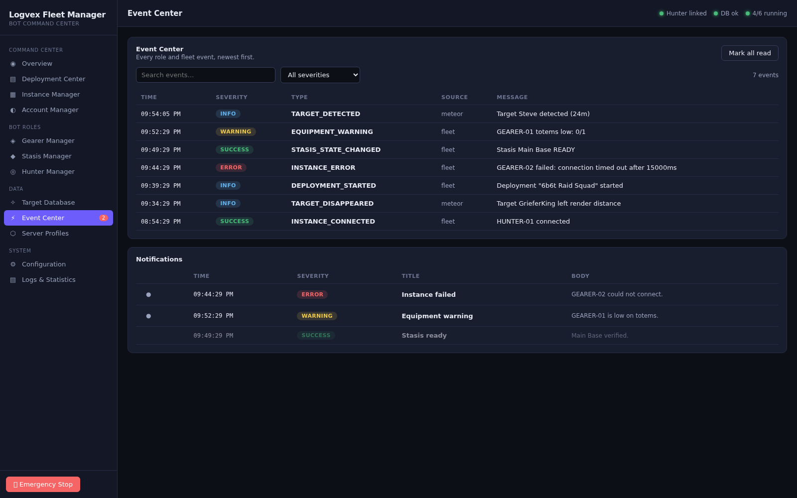 |
| Target Database | Event Center |
| 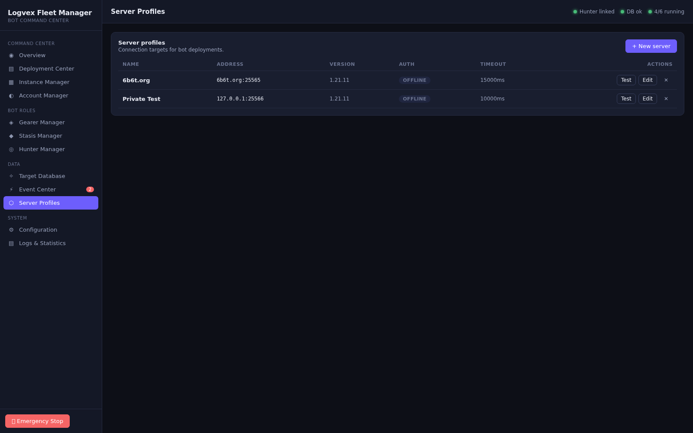 | 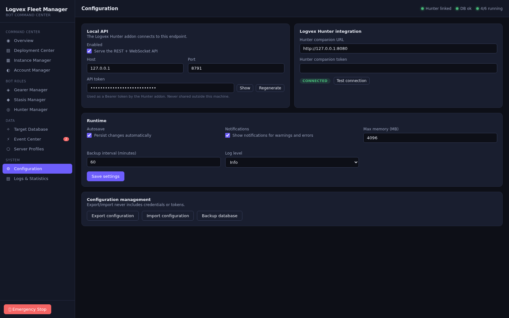 |
| Server Profiles | Configuration |
| 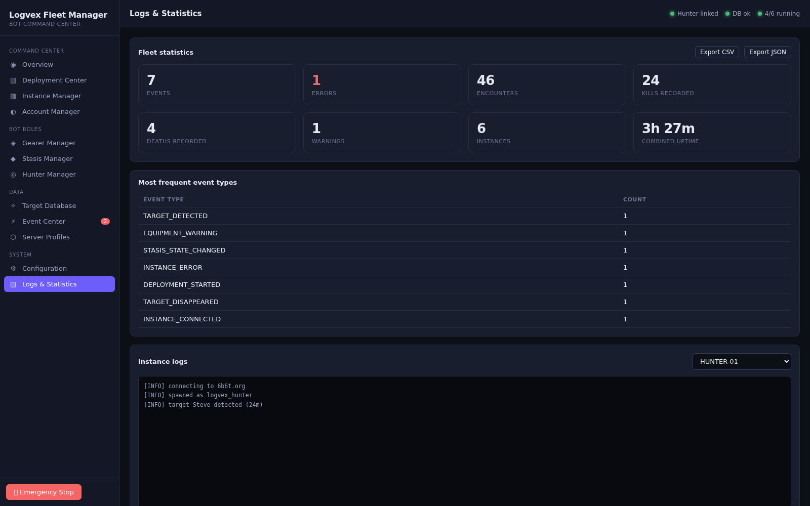 | |
| Logs & Statistics | |

The screenshots are captured from the renderer in demo mode (`?demo`), so they render without a
live backend. To regenerate them:

```bash
npm run dev:renderer -- --port 5173 --host 0.0.0.0   # in one terminal
npm run screenshots                                   # in another
```

The script (`scripts/capture-screenshots.mjs`) drives headless Chromium over the DevTools
Protocol, visiting each page via `?demo&page=<id>` at 1600x1000. Set `CHROME` if Chromium is not
on the default path, or `BASE_URL` to point at a different dev server.

---

## Requirements

- **Node.js 20+** (the project is developed and tested on Node 20/22; `better-sqlite3` and
  `keytar` ship prebuilt binaries for common platforms).
- A desktop OS supported by Electron (Windows, macOS, Linux).

## Install

```bash
cd fleet-manager
npm install
```

`keytar` is an optional dependency: if it cannot be installed, the app automatically falls back to
an encrypted-file credential vault (see `src/main/security/credential-vault.ts`).

## Run

```bash
# Development: Vite dev server + Electron, hot reload.
npm run dev

# Production build + launch.
npm run build
npm start
```

## Build & package

```bash
npm run build          # type-check main, bundle the renderer into dist/
npm run package:linux  # AppImage + deb
npm run package:win    # NSIS installer
```

## Test & type-check

```bash
npm test               # Vitest: unit + integration
npm run typecheck      # tsc for renderer and main
```

---

## Architecture

```
src/
├── shared/            Types and constants shared by main and renderer (single source of truth).
├── main/              Electron main process (Node).
│   ├── index.ts       App bootstrap: context, API, window, IPC, shutdown.
│   ├── context.ts     AppContext: wires db, repositories, vault and services. Electron-free.
│   ├── db/            SQLite schema/migrations and typed repositories.
│   ├── api/           Local HTTP + WebSocket API and its token auth.
│   ├── ipc/           IPC handlers exposed to the renderer through the preload bridge.
│   ├── security/      Credential vault (keytar or encrypted-file fallback).
│   ├── services/      Domain services: accounts, groups, instances, deployment, roles,
│   │                  hunter client + target sync, stasis, equipment, events, diagnostics.
│   └── mineflayer/    Worker supervisor, bot worker, collectors and role task scripts.
└── renderer/          React UI (Vite).
    ├── App.tsx        Shell: sidebar navigation, top bar, toasts.
    ├── lib/           Typed API bridge, state store, demo backend.
    ├── components/    Reusable UI primitives.
    └── pages/         One component per screen.
```

### Key design points

- **Isolation.** Every bot runs in a separate worker process managed by `WorkerSupervisor`; the UI
  and main process never block on a bot.
- **Testable core.** `AppContext` and every service are constructed without Electron, so the whole
  backend can be exercised in-process over an in-memory database (see `tests/integration`).
- **One event stream.** Services publish to an `EventBus`; the UI subscribes over IPC and the API
  over WebSocket, so both see the same events.
- **Safe credentials.** Passwords never live in the database; the vault stores them and the
  database only holds a reference.

---

## Connecting to LogVex Hunter

The Hunter Manager page and the Target Database sync both use the LogVex Hunter companion API. In
the addon:

```
.hunter companion start
.hunter companion token     # copy this token
```

Then in the Fleet Manager's Configuration page set the Hunter base URL (e.g.
`http://127.0.0.1:8720`) and the token. The client calls:

| Method | Path | Purpose |
| --- | --- | --- |
| GET | `/health` | connection + version |
| GET | `/api/v1/snapshot` | bot, players, targets, modules, stats |
| GET | `/api/v1/modules` | module states |
| GET | `/api/v1/players` | visible players |
| POST | `/api/v1/command` | administrative command |
| POST | `/api/v1/notify` | show a local notification in the client |

A client that is offline, misconfigured or missing simply shows as disconnected; nothing throws
into the UI.

---

## License

MIT — see the repository root [LICENSE](../LICENSE).
