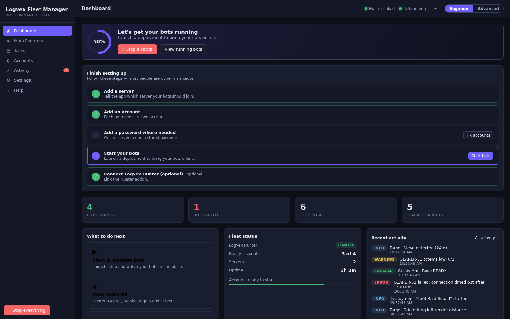
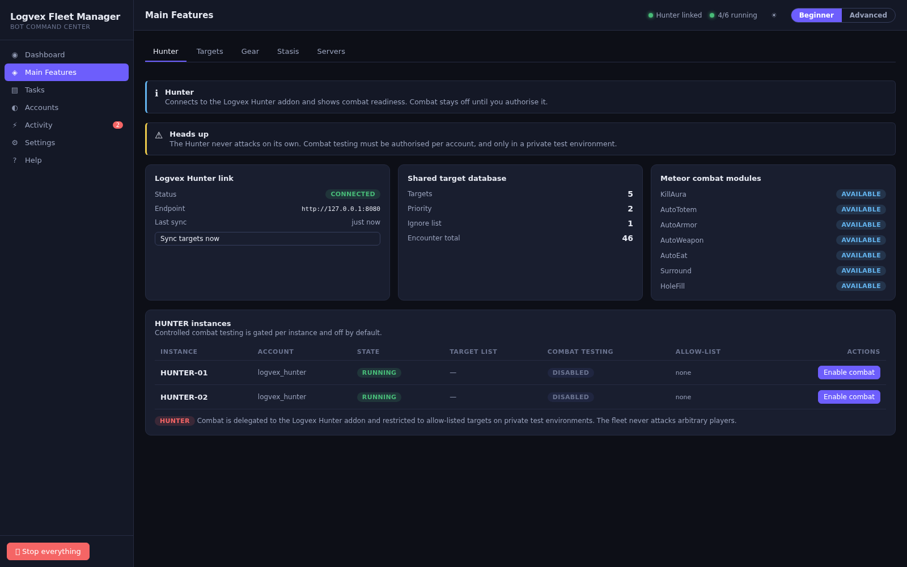
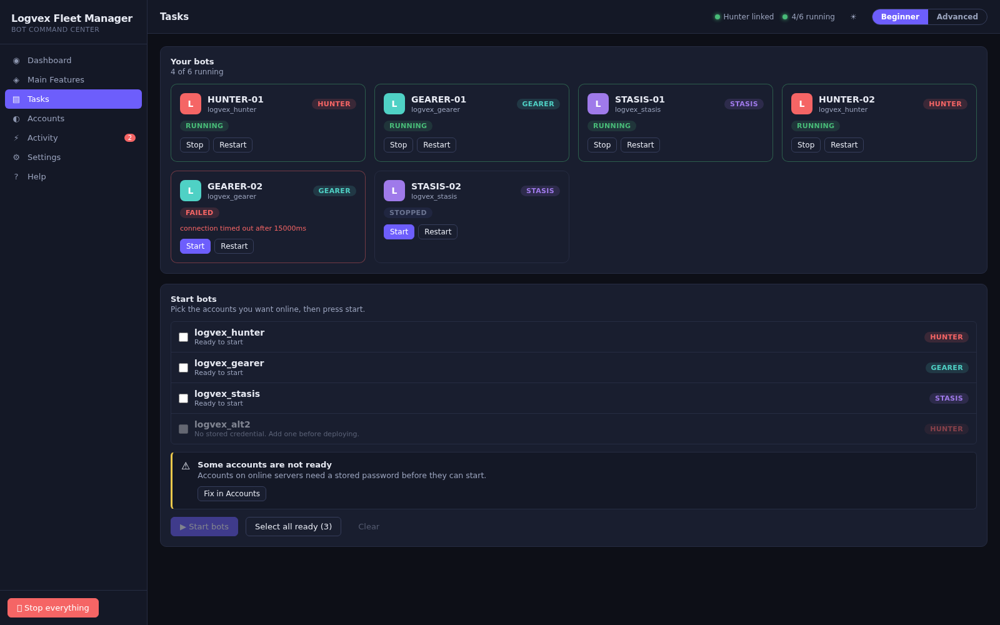
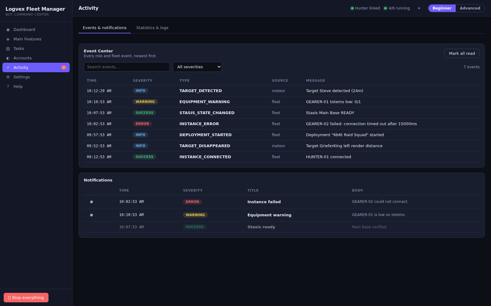
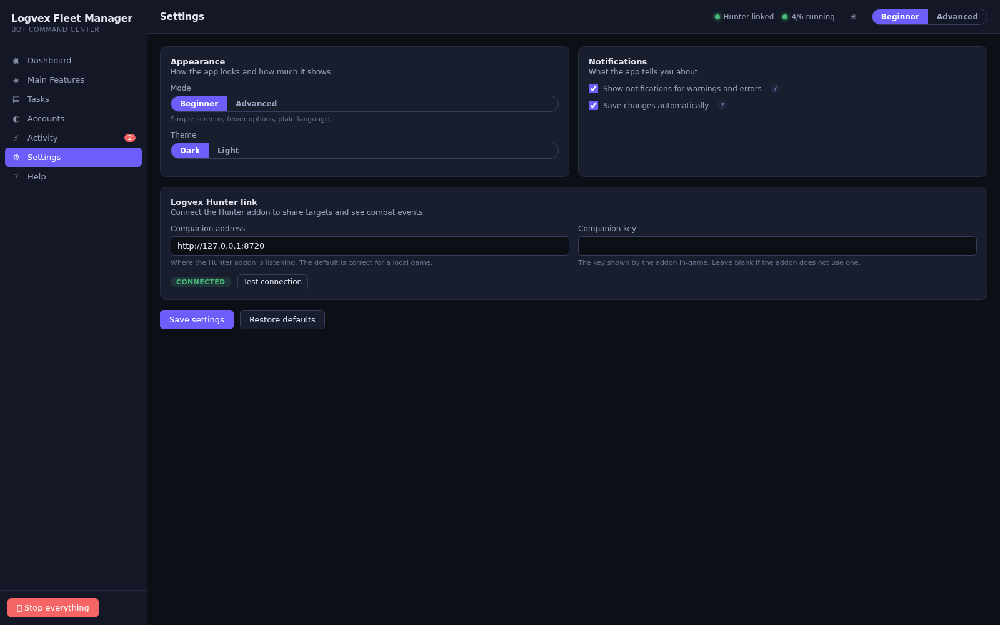
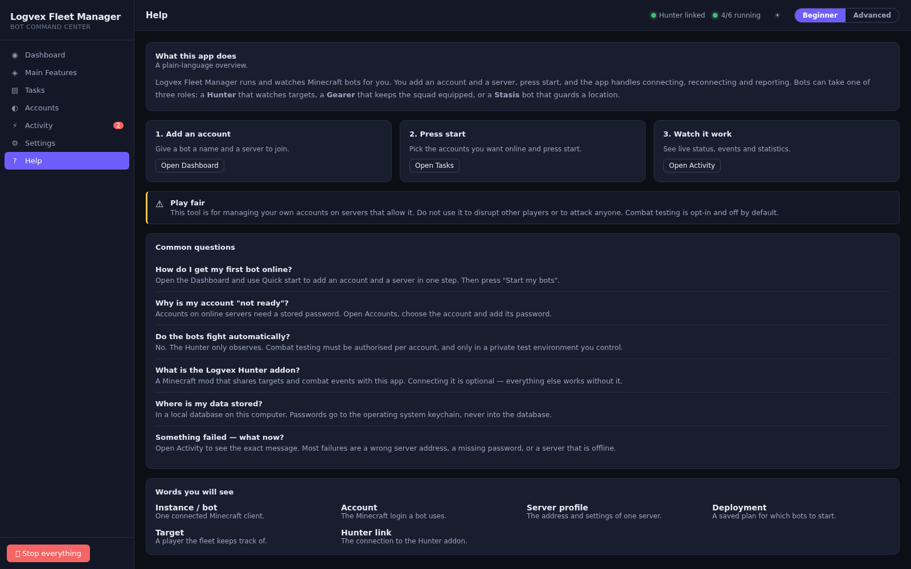

# Logvex Fleet Manager

A desktop command center for running and supervising a fleet of Minecraft bot instances. Add an
account and a server, press **Start**, and the app handles connecting, reconnecting and reporting.
Bots can take one of three roles (**GEARER**, **STASIS** or **HUNTER**), and the app can connect to
one or more **LogVex Hunter** Meteor clients over their companion API.

Built with **Electron + React + TypeScript + Vite**. Each bot runs in its own isolated Node worker
process, so one crashing or hanging bot never takes down the application.



---

## Getting started in 60 seconds

1. **Open the app.** The Dashboard tells you exactly what to do next.
2. **Add an account.** Use *Quick start* on the Dashboard (or the Accounts page) to add an account
   and a server in one step.
3. **Press Start.** Pick the accounts you want online and press **Start my bots**.
4. **Watch it work.** The Dashboard and the Activity page show live status, events and statistics.

Everything has sensible defaults. You never have to edit a configuration file to get going.

### Beginner and Advanced modes

The app starts in **Beginner mode**: simple screens, plain language and only the options that
matter. Switch to **Advanced mode** (top-right, or in Settings) to reveal the full deployment
builder, queue editor, role configuration and technical settings. Both modes are the same
application — no features are removed, only revealed.

---

## Features

Navigation is deliberately small — seven sections, each with a clear job:

- **Dashboard** — what is happening now, a guided setup checklist, one-click *Start my bots*, the
  live state of every bot and recent activity.
- **Main Features** — the fleet's capabilities behind one set of tabs: **Hunter** (LogVex Hunter
  link and combat readiness), **Targets** (the shared target list), **Gear** (equipment profiles
  and warnings), **Stasis** (defensive locations) and **Servers** (connection profiles).
- **Tasks** — start and manage bots. Beginner mode is a single "pick and press start" flow;
  Advanced mode exposes the full deployment builder, queue, validation preview and live monitor.
- **Accounts** — register offline/Microsoft accounts, store credentials in the OS keychain (with an
  encrypted-file fallback) and prepare logins.
- **Activity** — the event feed, notification inbox, statistics and live per-bot logs.
- **Settings** — grouped, plain-language options with tooltips, an optional Advanced section and a
  **Restore defaults** button.
- **Help** — a short guide, a glossary and answers to common questions.

### Cross-cutting
- **One-click operations** — *Quick start* creates a server + account; *Start my bots* builds and
  launches a deployment; *Stop everything* halts the whole fleet.
- **Friendly errors** — technical failures are translated into a plain explanation and a suggested
  fix, with a **Copy technical details** option for debugging.
- **Emergency stop** — one control halts every instance and cancels deployments; every destructive
  action asks for confirmation first.
- **Local HTTP + WebSocket API** — the same functionality as the UI, for automation, at
  `/api/v1/*` with `/events` for the event stream (token-authenticated).
- **Resilient Hunter integration** — an unreachable addon degrades to "disconnected" instead of
  throwing into the UI.
- **Light and dark themes**, remembered between sessions, with a responsive layout.

---

## Screenshots

| | |
| --- | --- |
|  |  |
| Dashboard | Main Features |
|  |  |
| Tasks | Accounts & Profiles |
|  |  |
| Activity | Settings |
|  | |
| Help | |

The screenshots are captured from the renderer in demo mode (`?demo`), so they render without a
live backend. To regenerate them:

```bash
npm run dev:renderer -- --port 5173 --host 0.0.0.0   # in one terminal
npm run screenshots                                   # in another
```

The script (`scripts/capture-screenshots.mjs`) drives headless Chromium over the DevTools
Protocol, visiting each page via `?demo&page=<id>` at 1600x1000. Old page ids (such as
`?page=overview` or `?page=deployment`) are still accepted and redirect to the matching new
section. Set `CHROME` if Chromium is not on the default path, or `BASE_URL` to point at a different
dev server.

---

## Requirements

- **Node.js 20+** (the project is developed and tested on Node 20/22; `better-sqlite3` and
  `keytar` ship prebuilt binaries for common platforms).
- A desktop OS supported by Electron (Windows, macOS, Linux).

## Install

```bash
cd fleet-manager
npm install
```

`keytar` is an optional dependency: if it cannot be installed, the app automatically falls back to
an encrypted-file credential vault (see `src/main/security/credential-vault.ts`).

## Run

```bash
# Development: Vite dev server + Electron, hot reload.
npm run dev

# Production build + launch.
npm run build
npm start
```

## Build & package

```bash
npm run build          # type-check main, bundle the renderer into dist/
npm run package:linux  # AppImage + deb
npm run package:win    # NSIS installer
```

## Test & type-check

```bash
npm test               # Vitest: unit + integration
npm run typecheck      # tsc for renderer and main
```

---

## Architecture

```
src/
├── shared/            Types and constants shared by main and renderer (single source of truth).
├── main/              Electron main process (Node).
│   ├── index.ts       App bootstrap: context, API, window, IPC, shutdown.
│   ├── context.ts     AppContext: wires db, repositories, vault and services. Electron-free.
│   ├── db/            SQLite schema/migrations and typed repositories.
│   ├── api/           Local HTTP + WebSocket API and its token auth.
│   ├── ipc/           IPC handlers exposed to the renderer through the preload bridge.
│   ├── security/      Credential vault (keytar or encrypted-file fallback).
│   ├── services/      Domain services: accounts, groups, instances, deployment, roles,
│   │                  hunter client + target sync, stasis, equipment, events, diagnostics.
│   └── mineflayer/    Worker supervisor, bot worker, collectors and role task scripts.
└── renderer/          React UI (Vite).
    ├── App.tsx        Shell: sidebar navigation, top bar, toasts.
    ├── lib/           Typed API bridge, state store, demo backend.
    ├── components/    Reusable UI primitives.
    └── pages/         One component per screen.
```

### Key design points

- **Isolation.** Every bot runs in a separate worker process managed by `WorkerSupervisor`; the UI
  and main process never block on a bot.
- **Testable core.** `AppContext` and every service are constructed without Electron, so the whole
  backend can be exercised in-process over an in-memory database (see `tests/integration`).
- **One event stream.** Services publish to an `EventBus`; the UI subscribes over IPC and the API
  over WebSocket, so both see the same events.
- **Safe credentials.** Passwords never live in the database; the vault stores them and the
  database only holds a reference.

---

## Connecting to LogVex Hunter

The Hunter Manager page and the Target Database sync both use the LogVex Hunter companion API. In
the addon:

```
.hunter companion start
.hunter companion token     # copy this token
```

Then in the Fleet Manager's **Settings** page set the Hunter base URL (e.g.
`http://127.0.0.1:8720`) and the token. The client calls:

| Method | Path | Purpose |
| --- | --- | --- |
| GET | `/health` | connection + version |
| GET | `/api/v1/snapshot` | bot, players, targets, modules, stats |
| GET | `/api/v1/modules` | module states |
| GET | `/api/v1/players` | visible players |
| POST | `/api/v1/command` | administrative command |
| POST | `/api/v1/notify` | show a local notification in the client |

A client that is offline, misconfigured or missing simply shows as disconnected; nothing throws
into the UI.

---

## License

MIT — see the repository root [LICENSE](../LICENSE).
