# Logvex Fleet Manager (Host)

The **Host** half of the Logvex bot platform. It does not run bots itself and it does not need a
Minecraft account: it is a control plane. Real Minecraft clients that are already running the
the **Logvex Hunter** mod (whose Worker half dials *out* to the Host over a WebSocket), register themselves,
and then accept a closed set of tasks. The Host is where you watch and command them.

That design has one big consequence: **the Host never needs an inbound port on a bot machine.** Each
worker makes an outbound connection to the Host, so it works from behind NAT, from a home network,
from a container, or from a machine you cannot otherwise reach. Adding a bot is "start Minecraft
with the worker mod installed", nothing more.

Built with **Electron + React + TypeScript + Vite**. The main process is Electron-free below the
window layer, so the whole backend is exercised in-process by the test suite.

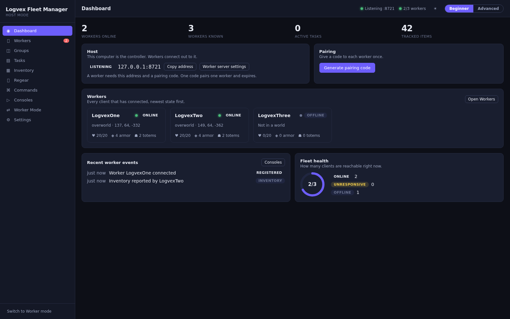

---

## Two halves, one protocol

```
        Logvex Worker (Minecraft client)            Logvex Fleet Manager (this app)
        ─────────────────────────────────           ────────────────────────────────
   ┌───────────────────────────────┐           ┌──────────────────────────────────┐
   │  Logvex Hunter mod (Fabric)   │  dials →  │  Worker server (ws://host:8721)  │
   │  • reads the client           │  out      │  • authenticates + pairs         │
   │  • executes named tasks       │  ←────────│  • stores snapshots & inventory  │
   │  • reconnects forever         │   tasks   │  • dispatches tasks, records     │
   └───────────────────────────────┘           │  • the dashboard, the API        │
                                               └──────────────────────────────────┘
```

- The worker is a Fabric/Meteor mod you drop into a bot's `mods/` folder. See
  [`../README.md#worker-part-of-the-same-mod`](../README.md#worker-part-of-the-same-mod).
- The Host is this app. It listens on one WebSocket port and one local HTTP API port, both on the
  Host machine only.

---

## Getting started

1. **Install and open the Host.**

   ```bash
   cd host
   npm install
   npm run dev          # Vite + Electron with hot reload
   # or: npm run build && npm start
   ```

2. **Pick Host mode.** On first run the app asks whether this machine is the Host or a Worker. This
   app is the Host; the Worker choice only explains where to get the mod.

3. **Read the connection address.** The Dashboard shows the address your workers should dial, e.g.
   `ws://192.168.1.20:8721`. Press **Copy address**.

4. **Pair a worker.** Press **Generate pairing code**. It shows a short code (for example `ABCD2345`)
   valid for a few minutes. In the Minecraft client, install the worker mod and put the code in its
   config:

   ```json
   { "host": "192.168.1.20", "port": 8721, "pairingCode": "ABCD2345" }
   ```

   The worker connects, presents the code once, and the Host answers with the shared token. The
   worker stores the token and uses it from then on, so the code is never needed again.

5. **Watch it work.** The worker appears on the Dashboard with its world, coordinates, health, gear
   and heartbeat age, and can now be given tasks.

Everything has sensible defaults. You never have to hand-edit a Host config file to get going.

### Beginner and Advanced modes

Beginner mode shows plain-language screens and only the options that matter. Advanced mode (top
right, or in Settings) reveals the technical settings. Both are the same application; nothing is
removed, only revealed.

---

## What the Host can do

Navigation is small on purpose — each page has one job:

- **HIVE MODE** — the swarm command layer. It coordinates the connected workers as one unit instead
  of one at a time: enable it, assign each worker a **role**, pick a **formation**, and steer the
  whole group with a plain instruction ("Everyone follow me", "Scout the surrounding area", "Send
  two Workers to explore the northern area"). The page shows a live canvas map of the swarm (worker
  positions, formation targets, explored sectors, shared sightings), the roster with per-worker role
  and health, the shared **objective queue** (one queue for the whole hive, so two workers never
  hold the same objective), the shared intelligence the swarm has reported, and the command history.
  A commander anchors the formation; every other worker follows its own role. Emergency stop
  cancels every objective at once. See [HIVE MODE](#hive-mode) below.
- **Dashboard** — what is happening now: worker totals (online/offline/degraded), active tasks,
  tracked items, a per-group breakdown, the pairing-code panel and the recent events.
- **Workers** — every client that has connected, with live state, a per-worker inspector and the
  controls: refresh status, pull inventory, ask position, send a command, send chat, socket ping,
  kick, forget, label, group and notes. Label, group and notes are host-side bookkeeping only.
  Remote **service controls** (Connect, Pause, Resume, Restart, Disconnect) can be sent to one
  worker or to every selected worker at once; the state shown is the `paused`/`stopped` flag the
  worker itself reported, not an assumption that the command landed.
- **Worker Mode** — the other side of the Workers page: it makes *this* machine a worker, connecting
  out to a host with the same protocol the Fabric mod speaks. Use it to validate a host before
  enrolling bots, and to write the `logvex-worker.json` an operator drops into each bot's `mods/`
  folder. It shares nothing with the host settings, so a machine is never half-host and half-worker.
- **Groups** — named, coloured groups used for bulk actions and item counting.
- **Tasks** — dispatch a task kind (including **EFly**: engage the client's *own* elytra flight, with
  optional target coordinates, mode and minimum height) to one worker or many, with a live history
  (status, duration, result/error). Mutating kinds are exclusive per worker, so a flight and a regear
  can never race.
- **Multiverse** — the organisational half of the product, in seven tabs. **Servers** holds named
  server profiles (host, port, version, environment, tags) that workers can be assigned to.
  **Templates** are group blueprints that create a group and its default task and equipment presets
  in one step. **Task presets** are reusable dispatch bundles you can run against a preset's own
  target set. **Schedules** fire a preset on an interval or a daily time, with a missed-fire count.
  **Automation** maps a host event (worker registered, task failed, and so on) to an action with an
  optional cooldown and run cap. **Containers** lists the container captures workers have reported.
  **Audit** is the append-only trail of every create, update and delete, so a change is never
  anonymous. Every tab talks to the real service through the preload bridge.
- **Consoles** — the log lines a worker forwarded about itself (connect, register, task outcomes,
  errors), newest last, with a clear button. This is the client's own view, not the Host's guess.
- **Inventory** — a worker's last *reported* inventory (with its capture time) and a fleet-wide item
  count for a friendly query such as `totem`, `gapple` or `diamond`, scoped to a group.
- **Commands** — send a server command or a chat line to many workers at once, with the audit log of
  what was sent and what each worker answered.
- **Regear** — loadout presets and a per-worker comparison between the preset and the last reported
  inventory, plus a fleet sweep. Moves are **off** by default (a dry run that only reports).
- **Statistics** — one honest report over the Host's own records: worker counts by status, group and
  version; task outcomes (completion rate, failure rate, average duration) computed over *finished*
  tasks only; a 24-hour activity histogram of tasks and commands; breakdowns of tasks by kind,
  status and actor, of events by type and of audit entries by action; and inventory totals. A metric
  with no data behind it reads **"no data"** rather than a zero, because a 0% completion rate and
  "nothing has finished yet" mean very different things. Export the whole report as JSON or CSV.
- **Settings** — grouped, plain-language options, the worker server address, tokens, and a
  **Restore defaults** button.

### Two ideas that are kept apart

- A worker's **reported** inventory is the last snapshot it sent. It may be seconds or minutes old,
  so every view labels it with when it was captured and flags it stale after a minute.
- A worker's **accessible** inventory is only what is inside a container screen it currently has
  open. The app never claims the two are the same, and it never opens a container for you.

---

## HIVE MODE

HIVE MODE coordinates the connected workers as **one unit** rather than one at a time. It is a
coordinator, not a second control path: every order it issues is dispatched through the *same* task
and command plumbing the Workers page uses, so a hive order behaves exactly like a hand-sent task —
same validation, same per-worker exclusivity, same reported result.

The model is four ideas:

- **Roles.** Each worker has one role — `COMMANDER`, `ESCORT`, `SCOUT`, `BUILDER`, `MINER`,
  `LOGISTICS`, `STORAGE`, `GUARD`, `SUPPORT` or `GENERALIST`. A role is what the worker *is for*; it
  decides which objectives the hive will offer it (a `SCOUT` gets scouting, a `MINER` gets mining,
  and so on). Roles are stored per worker and survive a restart.
- **Formations.** `follow`, `circle`, `line`, `diamond`, `escort` and `scatter`. Each non-commander
  worker is given a formation offset relative to the commander, computed by a pure function
  (`packages/hive/formations.ts`) so the geometry is unit-tested and deterministic.
- **Objectives.** One shared queue. Objectives are derived from a role, its needs and the area to
  cover, then handed out **one at a time** — two workers never hold the same objective. Scout orders
  divide the surrounding area into sectors (`packages/hive/sectors.ts`) and mark each as assigned or
  explored.
- **Observations.** Shared intelligence: what a worker saw and where. A sighting is whatever a
  worker reported from normal play — the hive never invents a position or pretends to see through
  another client's eyes.

Commands are understood by a small, closed parser (`packages/hive/commands.ts`) — the phrasings are
listed on the page. An instruction the parser does not recognise is **refused** with a reason rather
than guessed at, and the refusal is written to the command history like any other.

Everything the hive does is recorded: `hive_roles`, `hive_objectives`, `hive_observations`,
`hive_commands`, `hive_sectors` and `hive_state` (migration `0010_hive_mode`). The page polls the
coordinator every two seconds; **Emergency stop** cancels every objective and disables the hive in
one action.

---

## Pairing and authentication

There are two credentials, both generated on the Host and both regenerable from Settings:

- **Worker token** — the long-lived shared secret. A worker that already has it authenticates
  silently on every reconnect.
- **Pairing code** — a short, single-use, expiring code so you do not have to copy the long token
  onto a bot machine by hand. The first `hello` that carries a valid code is answered with the shared
  token; the code is consumed immediately.

A worker that presents neither, or a stale code, is refused with a reason the client logs. The Host
also refuses any worker whose protocol version does not match, rather than guessing at a payload it
does not understand.

---

## Protocol

The envelope is JSON: `{ v, type, id, payload }`. The message types mirror
`src/main/java/com/logvex/worker/core/Protocol.java` and are re-declared in
`src/shared/workers.ts`. `tests/unit/worker-protocol-drift.test.ts` reads the Java file and asserts
the two agree, so a drift fails the build rather than reaching a user.

| Direction | Types |
| --- | --- |
| worker → host | `hello`, `register`, `status`, `inventory`, `equipment`, `result`, `progress`, `pong`, `error`, `log` |
| host → worker | `hello-ack`, `command`, `task`, `ping`, `kick` |
| task kinds | `status`, `inventory`, `count`, `search`, `equipment`, `regear`, `command`, `chat`, `position`, `efly`, `container-read`, `container-move`, `shulker-read`, `shulker-pack`, `shulker-unpack`, `restock`, `portal-scan`, `nl-task` |

The task kinds are a **closed set**. The Host never sends code, a class name or a shell command; it
sends one of these kinds with a validated payload, and the worker dispatches it through a fixed
switch. Task results are whatever the worker actually reported — a task that timed out or was
refused raises, so the UI can never mistake "asked" for "done".

---

## HTTP API

The same functionality as the UI, for scripts, at `/api/v1/*` with a bearer token (or `?token=`).
`/health` is open. The API is loopback-only by default.

| Method | Path | Purpose |
| --- | --- | --- |
| GET | `/health` | liveness (no token) |
| GET | `/api/v1/status` | host status |
| GET | `/api/v1/workers` | the roster with live state |
| GET | `/api/v1/workers/overview` | fleet totals |
| GET | `/api/v1/workers/{id}` | one worker |
| POST | `/api/v1/workers/{id}/task` | run a task (`{ "kind": "...", "params": {} }`) |
| POST | `/api/v1/workers/{id}/line` | send a command or chat line (`{ "kind": "command", "line": "..." }`) |
| GET | `/api/v1/workers/{id}/inventory` | the last reported inventory |
| GET | `/api/v1/workers/{id}/console` | the log lines that worker forwarded |
| DELETE | `/api/v1/workers/{id}/console` | clear that worker's console buffer |
| GET | `/api/v1/workers/count?item=totem` | a fleet-wide item count |
| GET | `/api/v1/workers/groups` | worker groups |
| GET | `/api/v1/workers/tasks` | recent task history |
| GET | `/api/v1/workers/commands` | the command audit log |
| GET | `/api/v1/workers/presets` | regear presets |
| GET | `/api/v1/servers` | server profiles (`?archived=true` includes archived) |
| GET | `/api/v1/templates` | group templates |
| GET | `/api/v1/presets` | task presets |
| POST | `/api/v1/presets/{id}/run` | run a task preset against its own target set |
| GET | `/api/v1/schedules` | schedules, each with its missed-fire count |
| GET | `/api/v1/rules` | automation rules |
| GET | `/api/v1/containers` | container records (`?workerId=` filters) |
| GET | `/api/v1/audit` | the audit trail (`?limit=` up to 1000) |
| GET | `/api/v1/tags` | every tag in use |
| GET | `/api/v1/statistics` | the full statistics report the Statistics page renders |
| GET/POST | `/api/v1/storage/structures` | list or register a structure |
| GET | `/api/v1/storage/structures/issues` | structures needing attention |
| GET | `/api/v1/storage/structures/counts` | structure count by kind |
| POST | `/api/v1/storage/structures/preview-change` | what a proposed change in a region would touch (`{ "region": { ... } }`) |
| PATCH/DELETE | `/api/v1/storage/structures/{id}` | edit or remove a structure |
| GET | `/api/v1/hive`, `/api/v1/hive/overview` | the whole hive state (members, objectives, observations, commands) |
| GET | `/api/v1/hive/map` | positions, formation targets, sectors and sightings for the live map |
| GET | `/api/v1/hive/roles` | the role catalogue |
| GET | `/api/v1/hive/objectives` | the shared objective queue |
| GET | `/api/v1/hive/observations` | shared sightings (players, structures) |
| GET | `/api/v1/hive/commands` | the command history (`?limit=`) |
| POST | `/api/v1/hive/state` | enable or disable the hive (`{ "enabled": true }`) |
| POST | `/api/v1/hive/formation` | set the formation (`{ "kind": "circle", "radius": 6 }`) |
| POST | `/api/v1/hive/command` | give the hive a plain instruction (`{ "instruction": "Everyone follow me." }`) |
| POST | `/api/v1/hive/emergency-stop` | cancel every objective and disable the hive |
| POST | `/api/v1/hive/observation` | record a shared sighting |
| POST | `/api/v1/hive/commander` | elect the commander (`{ "workerId": "w1" }`) |
| PUT/DELETE | `/api/v1/hive/roles/{workerId}` | assign a role or clear it |
| DELETE | `/api/v1/hive/objectives/{id}` | drop an objective from the queue |

---

## Screenshots

| | |
| --- | --- |
|  | 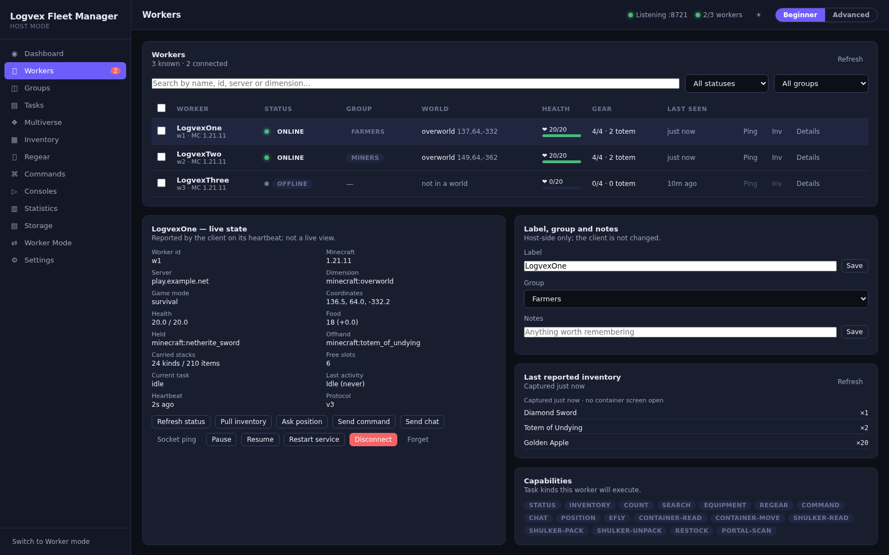 |
| Dashboard | Workers |
| 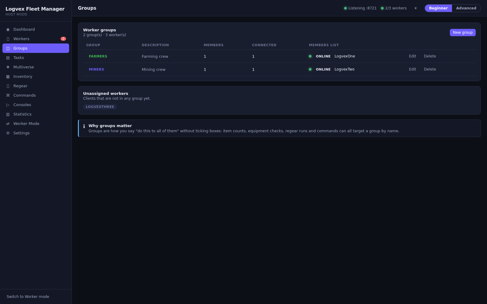 | 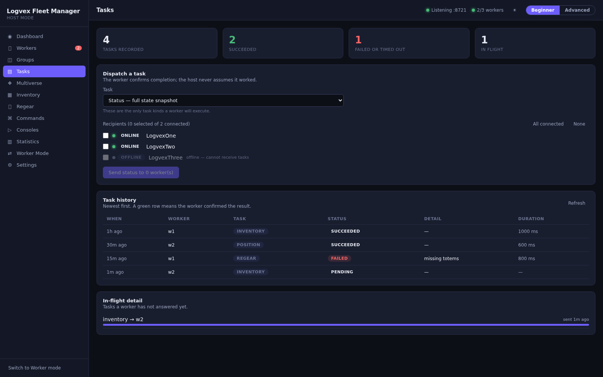 |
| Groups | Tasks |
| 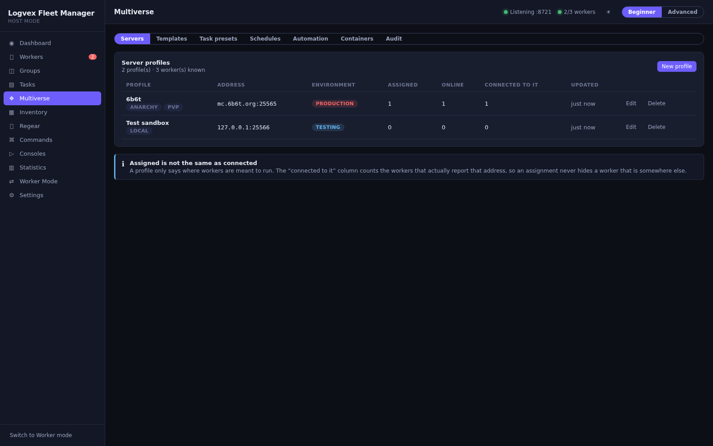 | 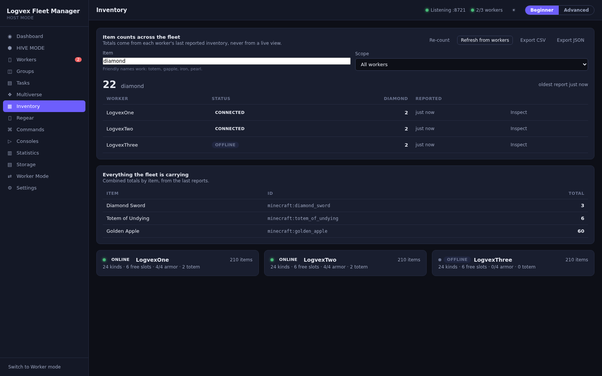 |
| Multiverse | Inventory |
| 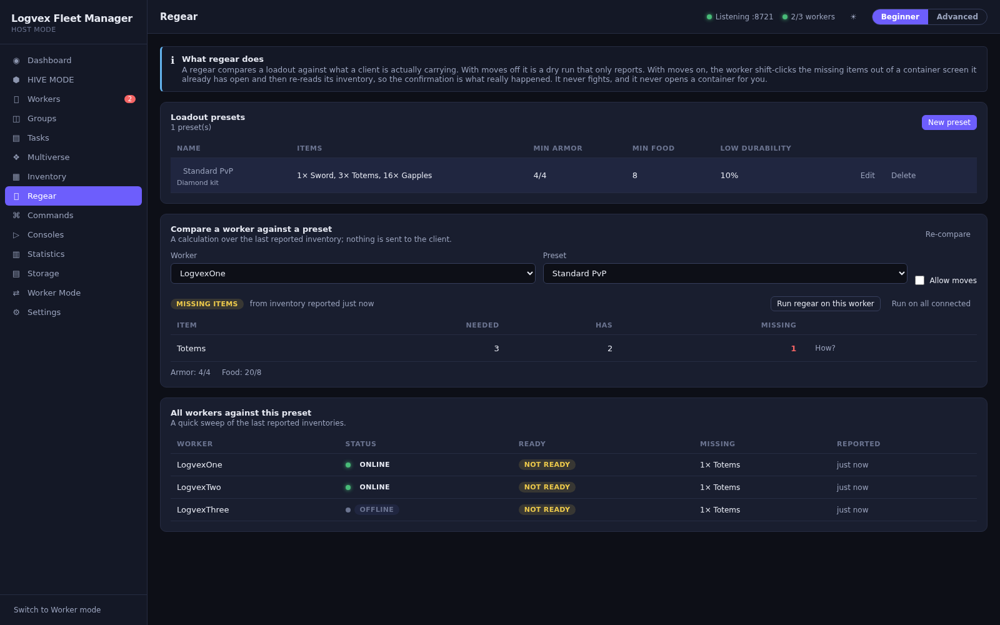 | 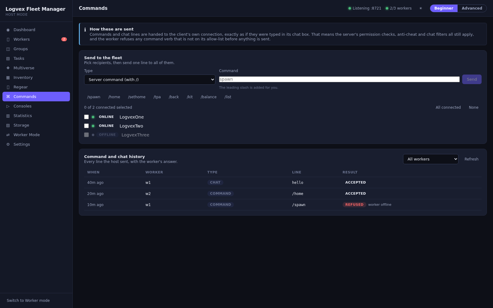 |
| Regear | Commands |
| 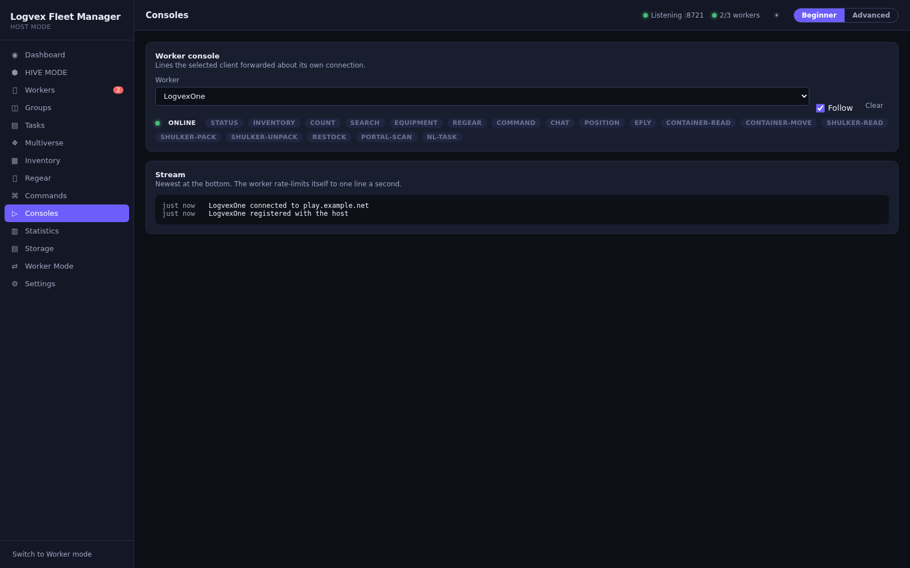 | 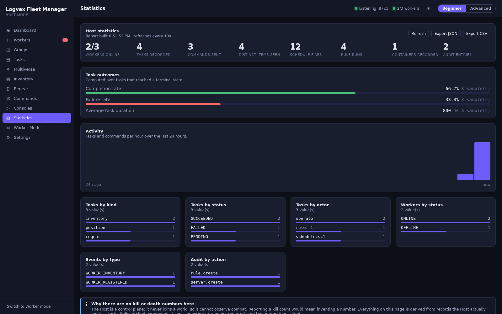 |
| Consoles | Statistics |
| 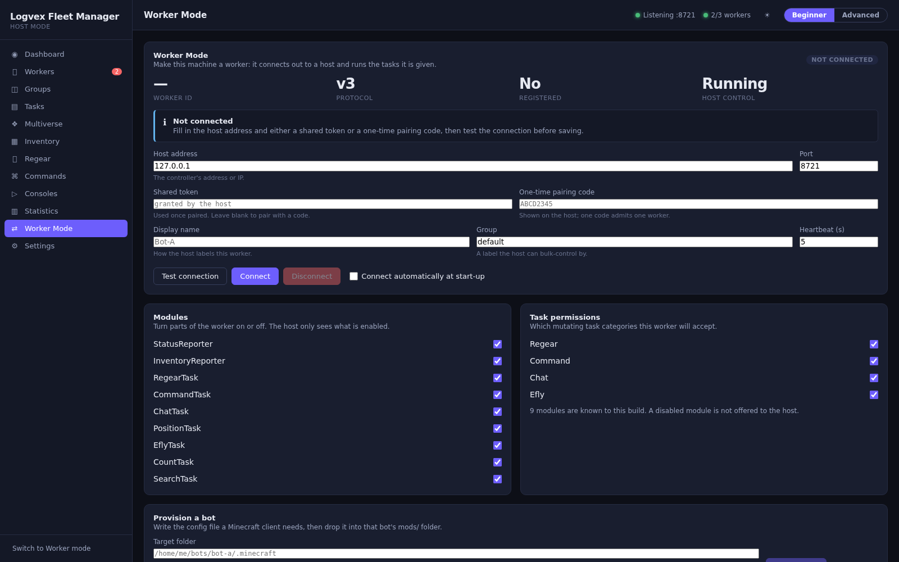 | 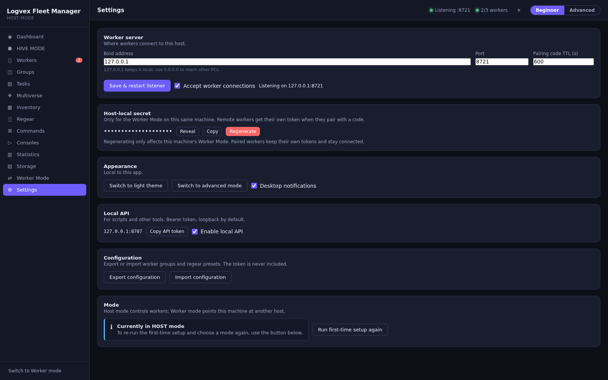 |
| Worker Mode | Settings |
| 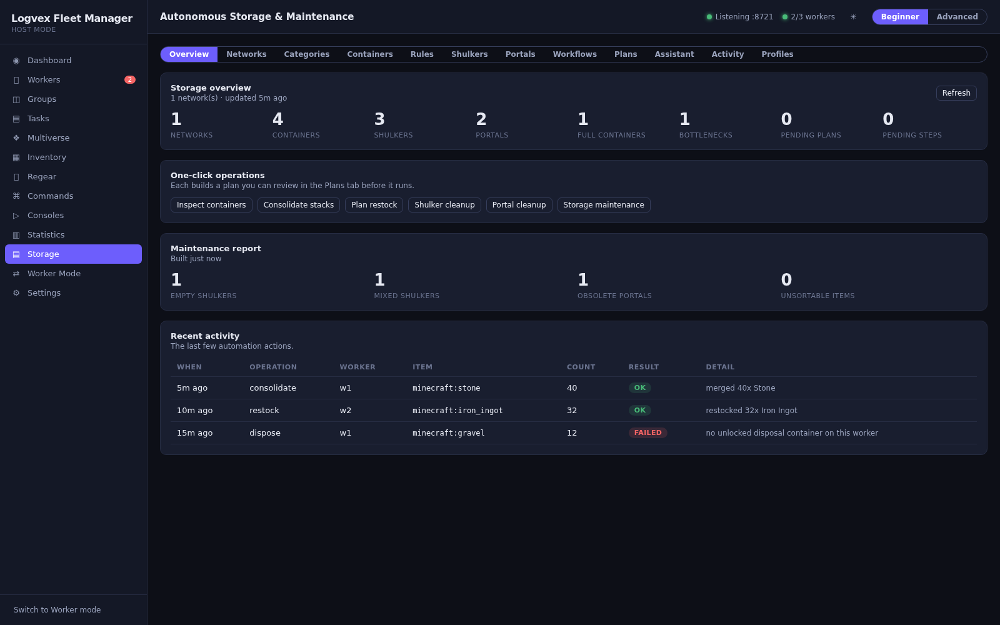 |  |
| Storage — overview | Storage — item categories |
| 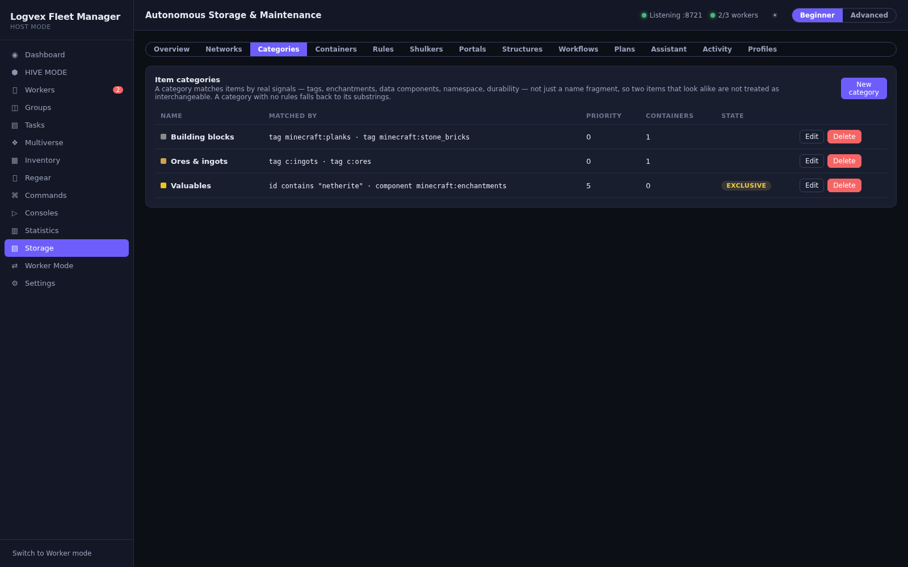 | 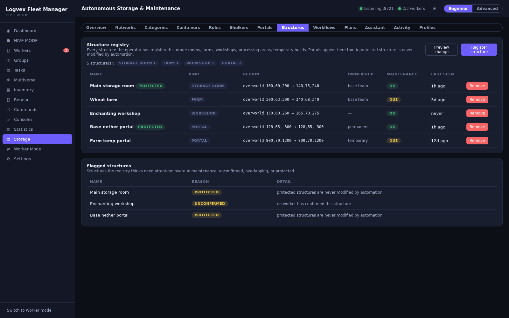 |
| Editing a category's classifier rules | Storage — the structure registry |
| 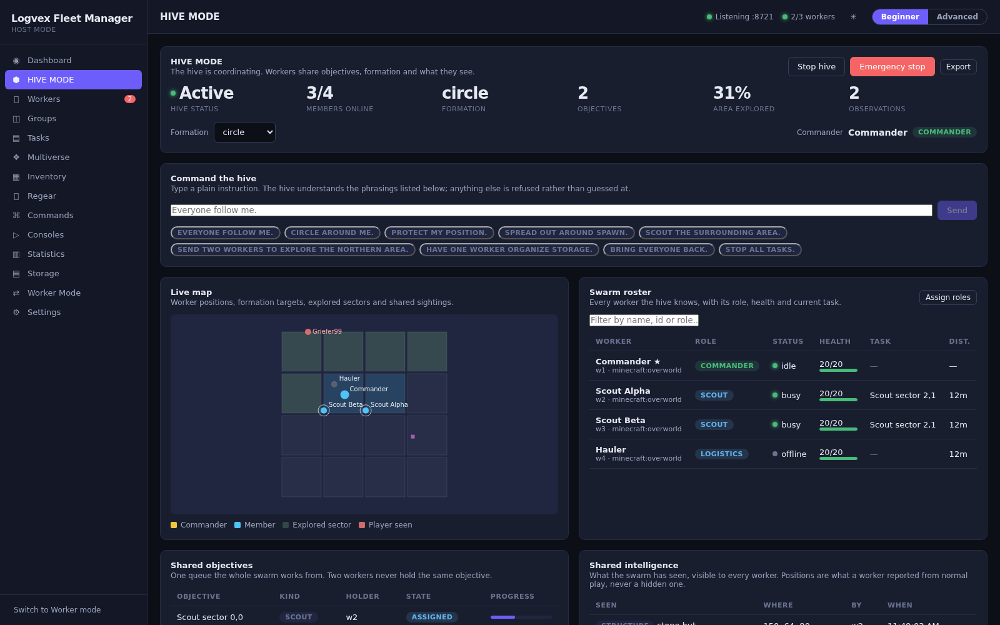 | |
| HIVE MODE — the swarm command layer | |

The screenshots are captured from the renderer in demo mode (`?demo`), so they render without a live
backend or a connected worker. To regenerate them:

```bash
npm run dev:renderer -- --port 5173 --host 0.0.0.0   # in one terminal
npm run screenshots                                   # in another
```

The script (`scripts/capture-screenshots.mjs`) drives headless Chromium over the DevTools Protocol,
visiting each page via `?demo&page=<id>` at 1600x1000. Set `CHROME` if Chromium is not on the default
path, or `BASE_URL` to point at a different dev server.

---

## Requirements

- **Node.js 20+** (developed and tested on Node 20/22; `better-sqlite3` ships prebuilt binaries for
  common platforms).
- A desktop OS supported by Electron (Windows, macOS, Linux).

## Build & package

```bash
npm run build          # type-check main, bundle the renderer into dist/
npm run package:linux  # AppImage + .deb  -> release/
npm run package:win    # NSIS installer   -> release/
```

Artifacts are written to `host/release/`. The Windows NSIS target needs Wine when built from
Linux (`apt-get install wine wine64`); the Linux targets need no extra tooling. `electron-builder`
reads the output directory from `build.directories.output`, so keep `release/` distinct from the
`dist/` bundle that goes *into* the app — otherwise each build packages the previous one.

## Test & type-check

```bash
npm test               # Vitest: unit + integration (includes a real worker handshake)
npm run typecheck      # tsc for renderer and main
```

The integration tests drive a **real worker-shaped WebSocket client** against the **real** Host
server over a real loopback socket, so the handshake, pairing, task round-trip, inventory cache and
regear comparison are all exercised end to end. The only thing faked is the Minecraft client itself,
which is exactly the boundary the protocol is meant to cross.

---

## Architecture

```
src/
├── shared/            Types and constants shared by main and renderer (single source of truth).
│   ├── types.ts       Domain types: workers, groups, tasks, inventory, events, settings.
│   ├── workers.ts     The worker protocol mirror + defensive envelope decoder.
│   ├── events.ts      The canonical event catalog and its schema version.
│   └── ipc.ts         The IPC channel names and their request/response shapes.
├── main/              Electron main process (Node).
│   ├── index.ts       App bootstrap: context, API, window, IPC, shutdown.
│   ├── context.ts     AppContext: wires db, repositories, worker server/service. Electron-free.
│   ├── db/            SQLite schema/migrations and typed repositories.
│   ├── api/           Local HTTP + WebSocket API and its token auth.
│   ├── ipc/           IPC handlers exposed to the renderer through the preload bridge.
│   ├── packages/      Pure, Minecraft-free engines (scheduler, rule-engine, statistics, telemetry,
│   │                  task/group/inventory/equipment engines). No Electron, no I/O — unit-tested.
│   ├── services/      The event bus (the one event stream) and MultiverseService (servers,
│   │                  presets, schedules, rules, containers, tags, audit).
│   └── workers/       The worker WebSocket server and WorkerService (the control plane).
└── renderer/          React UI (Vite).
    ├── App.tsx        Shell: sidebar navigation, top bar, toasts.
    ├── lib/           Typed API bridge, state store, demo backend.
    ├── components/    Reusable UI primitives.
    └── pages/         One component per screen.
```

### Key design points

- **The Host is a controller, not a runner.** It never launches Minecraft, never holds a game
  account, and never reads another client's world state directly. Everything it shows came from a
  worker's own report.
- **Testable core.** `AppContext` and the worker server are constructed without Electron, so the
  whole backend can be exercised in-process over an in-memory database (see `tests/integration`).
- **One event stream.** Services publish to an `EventBus`; the UI subscribes over IPC and the API
  over WebSocket, so both see the same events.
- **Failure is contained.** A worker that hangs, crashes or floods is bounded: task timeouts raise,
  console buffers are capped, and a stale connection is replaced when the same id reconnects.
- **Two items are never assumed interchangeable.** Storage categories carry real `ClassifierRule`s
  (tags, enchantments, data components, namespace, durability), read off the metadata the worker
  reports for each stack. A category with no rules falls back to id substrings, and metadata that was
  never reported is treated as unknown, never as absent. The **Categories** tab in the Storage page
  edits those rules directly.
- **A structure is a region, and a protected one is never touched.** The **Structures** tab registers
  storage rooms, farms, workshops, processing areas and temporary builds as inclusive boxes in one
  dimension, with an owner note and a maintenance state. The `structure-registry` package answers
  three questions over that registry: does a point fall inside a structure, does a proposed change
  overlap any structure, and which structures need attention (protected, overdue, unconfirmed,
  overlapping). A change preview lists every structure a proposed operation would touch and marks a
  protected one not actionable — the preview never performs anything. Registered portals are
  projected into the same registry, so one dashboard shows them alongside everything else.

---

## License

MIT — see the repository root [LICENSE](../LICENSE).
